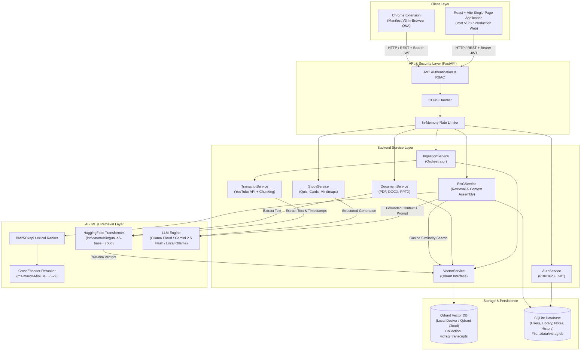
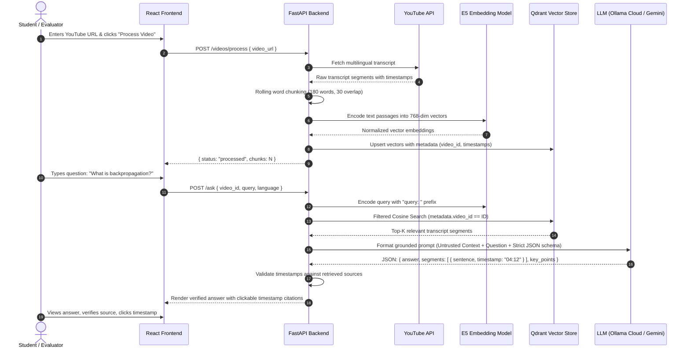

# VidRAG — AI-Powered YouTube Video Intelligence Platform

[](https://fastapi.tiangolo.com)
[](https://react.dev)
[](https://vitejs.dev)
[](https://qdrant.tech)
[](https://www.langchain.com)
[](https://opensource.org/licenses/MIT)

> **VidRAG** is an enterprise-grade multimodal Retrieval-Augmented Generation (RAG) platform that transforms lengthy YouTube videos and technical documents into interactive, source-grounded knowledge bases. It features semantic video search, timestamp-cited question answering, multilingual translation, automated AI study tools (quizzes, flashcards, mind maps, learning paths), multi-source cross-retrieval, and a Chrome browser extension.

---

## Table of Contents

- [Project Overview](#project-overview)
- [Problem Statement](#problem-statement)
- [Key Features](#key-features)
- [System Architecture](#system-architecture)
- [Complete Working Flow](#complete-working-flow)
- [Technology Stack](#technology-stack)
- [Installation Instructions (Windows PowerShell)](#installation-instructions-windows-powershell)
- [Environment Variables](#environment-variables)
- [Docker Setup](#docker-setup)
- [Cloud Deployment Guide](#cloud-deployment-guide)
- [Screenshots & User Interface](#screenshots--user-interface)
- [Testing & Quality Assurance](#testing--quality-assurance)
- [Limitations & Future Roadmap](#limitations--future-roadmap)
- [Project Attribution & Credits](#project-attribution--credits)
- [Author](#author)

---

## Project Overview

Online video lectures, tutorials, and technical conferences are among the richest educational resources available today. However, extracting specific insights from multi-hour videos requires tedious scrubbing, guessing playback positions, and manually synthesizing disjointed explanations.

**VidRAG** solves this problem by turning passive video watching into an active, conversational learning experience:
1. **Multimodal Ingestion**: Ingests public YouTube videos, entire playlists, uploaded PDFs, Word documents, PowerPoint presentations, and text files.
2. **Dense Multilingual Vector Indexing**: Converts transcripts and documents into overlapping time-anchored chunks embedded with state-of-the-art multilingual transformers (`intfloat/multilingual-e5-base`).
3. **Evidence-Grounded Reasoning**: Uses advanced RAG pipelines with LLM providers (Ollama Cloud, Google Gemini, or local Ollama) to answer user questions exclusively using retrieved source evidence.
4. **Verifiable MM:SS Citations**: Every answer provides direct timestamp citations, enabling users to jump directly to the exact point in the video where the concept was articulated.
5. **AI Study Studio**: Automatically generates structured revision notes, active-recall flashcards with recall scoring, practice multiple-choice quizzes with explanations, conceptual mind maps, and progressive learning paths.

---

## Problem Statement

When learners and professionals consume technical content on video platforms, they face three fundamental hurdles:

1. **Information Inaccessibility**: Video content is sequential and non-scannable. Finding an answer to a specific question in a 2-hour lecture often takes 20–30 minutes of random scrubbing.
2. **Language Barriers**: High-quality educational content is predominantly produced in English, creating a steep barrier for non-native speakers seeking answers in their native language (e.g., Hindi, Marathi, Spanish, etc.).
3. **Passive Retention & Hallucinations**: Standard video consumption leads to low retention. When users consult general-purpose conversational LLMs, the models frequently hallucinate facts because they lack direct grounding in the specific lecture being studied.

**VidRAG addresses these challenges** by establishing a deterministic, verifiable link between the AI's answers and the video's transcript timestamps, supporting cross-lingual queries and automated active-recall generation.

---

## Key Features

VidRAG has been built and verified with the following genuine functionality:

### 1. YouTube Video Processing & Ingestion
- Ingests public YouTube videos and Shorts using 11-character video IDs or full URLs.
- Fetches official and automatically generated transcripts across multiple languages with automatic fallback.
- Splits transcript segments into rolling word windows (180 words, 30-word overlap) with start and end timestamps.

### 2. Intelligent Video Question Answering & Verification
- Answers user questions strictly based on the video's transcript.
- Returns structured JSON responses containing:
  - Concise synthesized answer.
  - Sentence-level segments tied to `MM:SS` video timestamps.
  - Bulleted key takeaways.
  - Source evidence snippets with retrieval confidence indicator.
  - Suggested follow-up exploration questions.

### 3. Multilingual RAG & Cross-Language Queries
- Supports asking questions and receiving answers in over 15 languages, including:
  - English (`en`), Hindi (`hi`), Marathi (`mr`), Bengali (`bn`), Tamil (`ta`), Telugu (`te`), Urdu (`ur`), Spanish (`es`), French (`fr`), German (`de`), Portuguese (`pt`), Arabic (`ar`), Chinese (`zh`), Japanese (`ja`), and Italian (`it`).
- Automatic language detection or user-specified answer language.

### 4. AI Study Studio
Grounded directly in the ingested source material:
- **Practice Quizzes**: 4-option MCQs with answer index, explanation, and verbatim evidence quotes.
- **Interactive Flashcards**: Front/back cards with spacebar flip, arrow navigation, shuffle, and "Got it" / "Need practice" mastery tracking.
- **Structured Summaries**: Overview notes, key concepts, definitions glossary, and self-test revision prompts.
- **Conceptual Mind Maps**: Hierarchical topic trees with expandable branches and connection counts.
- **Step-by-Step Learning Paths**: Goal-oriented roadmaps with prerequisites and hands-on practice tasks.

### 5. Multi-Source Document Ingestion & Cross-Search
- Ingests text-based **PDF**, **DOCX**, **PPTX**, **TXT**, and **Markdown** documents up to 20 MB.
- Enables single-query cross-search across multiple videos and documents simultaneously.
- Tenant-scoped retrieval ensuring queries only access sources in the authenticated user's library.

### 6. Playlist Ingestion
- Batch indexing of public YouTube playlists up to 50 videos via `yt-dlp` metadata extraction.

### 7. User Workspace & Security
- User registration and login powered by **PBKDF2-SHA256** password hashing and **JWT** (JSON Web Tokens).
- SQLite relational persistence for personal video libraries, timestamped notes, conversation history, and feedback.
- Role-based access control with administrative overview and audit logs.

### 8. Chrome Extension (Manifest V3)
- Standalone browser extension to query YouTube videos directly inside the YouTube web player.

### 9. Multi-Provider LLM Architecture
- **Ollama Cloud** (default cloud): Fast inference using native OpenAI-compatible API (`nemotron-3-nano:30b-cloud`).
- **Google Gemini**: Deep reasoning via `gemini-2.5-flash` (`langchain-google-genai`).
- **Local Ollama**: 100% offline private execution with local hardware acceleration.

---

## System Architecture

The following diagram illustrates the end-to-end architecture of VidRAG:



---

## Complete Working Flow

From URL input to a verified answer:



---

## Technology Stack

| Domain | Technology / Library | Version | Purpose |
|---|---|---|---|
| **Frontend Framework** | **React** | 18 / 19 | Declarative single-page interface |
| **Frontend Tooling** | **Vite** | 5.x / 6.x | High-speed build system and HMR |
| **Icons & Design** | **Lucide React** | ^0.468 | Modern SVG iconography |
| **Backend Framework** | **FastAPI** | >=0.115 | Asynchronous RESTful API backend |
| **ASGI Server** | **Uvicorn** | >=0.30 | High-performance Python ASGI web server |
| **Vector Database** | **Qdrant** | v1.12+ | Vector similarity engine with metadata filtering |
| **Embedding Model** | **intfloat/multilingual-e5-base** | 768-dim | Normalized multilingual dense vector embeddings |
| **Lexical Search** | **rank-bm25** | >=0.2 | BM25Okapi sparse retrieval |
| **Reranker** | **Cross-Encoder (ms-marco)** | sentence-transformers | Deep neural passage reranking |
| **LLM Orchestration** | **LangChain** | >=0.3 | Prompts, parsers, and provider abstractions |
| **Cloud LLMs** | **Ollama Cloud / Google Gemini** | gemini-2.5-flash | Structured generation & grounded reasoning |
| **Local LLM** | **Ollama** | nemotron-3-nano | Offline inference fallback |
| **Document Processing** | **pypdf, python-docx, python-pptx** | Latest | Text extraction from documents |
| **YouTube Extraction** | **youtube-transcript-api, yt-dlp** | Latest | Transcript fetching and playlist parsing |
| **Relational Database** | **SQLite 3** | Built-in | User accounts, chat logs, notes, study items |
| **Authentication** | **PyJWT + PBKDF2-SHA256** | >=2.9 | Stateless JWT authorization & password hashing |
| **Containerization** | **Docker & Docker Compose** | Latest | Microservice containerization |

---

## Installation Instructions (Windows PowerShell)

Follow these step-by-step instructions to run VidRAG locally on Windows:

### 1. Clone the Repository

```powershell
git clone https://github.com/sriyans526/VID-RAG.git
cd VID-RAG
```

### 2. Configure Environment Variables

```powershell
Copy-Item .env.example .env
```

Open `.env` and set your preferred configuration. To generate a secure `JWT_SECRET`:

```powershell
python -c "import secrets; print(secrets.token_urlsafe(48))"
```

Paste this string into `JWT_SECRET` in `.env`.

### 3. Launch the Vector Database (Qdrant)

Make sure Docker Desktop is running, then start Qdrant:

```powershell
docker compose up -d qdrant
```

Verify that Qdrant is healthy by visiting:
```text
http://127.0.0.1:6333/dashboard
```

### 4. Set Up the Python Backend

```powershell
py -3.11 -m venv .venv
.\.venv\Scripts\Activate.ps1
python -m pip install --upgrade pip
pip install -r requirements.txt
```

Start the FastAPI backend:

```powershell
uvicorn main:app --reload --host 127.0.0.1 --port 8000
```

Verify the API is running at:
- Interactive API Docs: `http://127.0.0.1:8000/docs`
- Health Endpoint: `http://127.0.0.1:8000/health`

### 5. Set Up and Launch the React Frontend

In a separate PowerShell window:

```powershell
cd frontend
Copy-Item .env.example .env
npm install
npm run dev
```

Open your browser at `http://localhost:5173`. Create an account and begin processing videos!

---

## Environment Variables

The project uses `.env` files for configuration. A pre-configured template is provided in `.env.example`:

| Variable | Required | Default | Description |
|---|---|---|---|
| `LLM_PROVIDER` | Yes | `ollama_cloud` | LLM backend: `ollama_cloud`, `gemini`, or `ollama` |
| `OLLAMA_API_KEY` | If Ollama Cloud | — | Ollama Cloud API key from [ollama.com](https://ollama.com/settings/keys) |
| `OLLAMA_CLOUD_BASE_URL` | No | `https://ollama.com/v1` | Ollama Cloud API endpoint |
| `OLLAMA_CLOUD_MODEL` | No | `nemotron-3-nano:30b-cloud` | Cloud LLM model identifier |
| `OLLAMA_NUM_PREDICT` | No | `1024` | Maximum tokens generated per response |
| `GOOGLE_API_KEY` | If Gemini | — | Google Gemini API key from [AI Studio](https://aistudio.google.com/app/apikey) |
| `GEMINI_MODEL` | No | `gemini-2.5-flash` | Gemini model name |
| `OLLAMA_BASE_URL` | If Local Ollama | `http://localhost:11434` | Local Ollama daemon URL |
| `OLLAMA_MODEL` | If Local Ollama | `nemotron-3-nano:30b` | Local Ollama model name |
| `QDRANT_URL` | Yes | `http://localhost:6333` | Qdrant vector database URL (or Qdrant Cloud URL) |
| `QDRANT_API_KEY` | If Qdrant Cloud | — | Qdrant Cloud cluster API key |
| `QDRANT_COLLECTION` | No | `vidrag_transcripts` | Qdrant collection name (768 dimensions) |
| `JWT_SECRET` | Yes | — | Random 32+ character secret for JWT signing |
| `JWT_EXPIRE_MINUTES`| No | `1440` (24h) | JWT access token lifespan |
| `DATABASE_PATH` | No | `./data/vidrag.db` | Path to SQLite database file |
| `CORS_ORIGINS` | No | `http://localhost:5173,...` | Comma-separated allowed frontend origins |
| `PORT` | No | `8000` | Port for the backend server |
| `MAX_QUESTION_CHARS`| No | `2000` | Safety limit on query character count |

---

## Docker Setup

To run the entire backend and vector database in isolated containers:

```powershell
docker compose up --build -d
```

This starts:
- **`qdrant`**: Persistent vector database on `127.0.0.1:6333`.
- **`api`**: VidRAG FastAPI backend on `127.0.0.1:8000`.

To stop the services:
```powershell
docker compose down
```

---

## Cloud Deployment Guide

VidRAG is designed to be hosted online with zero local machine dependencies.

### 1. Vector Database: Qdrant Cloud (Free Tier)
1. Sign up at [cloud.qdrant.io](https://cloud.qdrant.io).
2. Create a **Free Tier Cluster** (1 GB RAM, 4 GB storage, free forever, no credit card required).
3. Copy your **Cluster URL** (e.g., `https://xyz-example.qdrant.tech:6333`) and **API Key**.
4. In your deployment environment variables, configure:
   ```env
   QDRANT_URL=https://xyz-example.qdrant.tech:6333
   QDRANT_API_KEY=your_qdrant_api_key_here
   ```
   *Note: The application automatically creates the `vidrag_transcripts` collection (768-dim, Cosine distance) upon initial startup.*

### 2. Backend & Frontend: Unified Render Deployment (Simplest & Free)
The FastAPI backend is configured to automatically serve the compiled React SPA from `frontend/dist` when accessed in a browser:
1. Create a free account at [render.com](https://render.com).
2. Click **New +** -> **Web Service** -> Connect your GitHub repository `sriyans526/VID-RAG`.
3. Set configuration:
   - **Environment**: `Python 3`
   - **Build Command**: `pip install -r requirements.txt && cd frontend && npm install && npm run build && cd ..`
   - **Start Command**: `uvicorn main:app --host 0.0.0.0 --port $PORT`
4. Add Environment Variables:
   - `LLM_PROVIDER`: `ollama_cloud` (or `gemini`)
   - `OLLAMA_API_KEY` or `GOOGLE_API_KEY`: Your key
   - `QDRANT_URL`: Your Qdrant Cloud URL
   - `QDRANT_API_KEY`: Your Qdrant Cloud API key
   - `JWT_SECRET`: A secure 32+ character string
   - `CORS_ORIGINS`: `*`
5. Click **Deploy**. Both the full React Web App and the FastAPI endpoints will be live at `https://your-service.onrender.com`.

### 3. Alternative: Decoupled Frontend on Vercel
If you prefer hosting the React frontend separately:
1. Import the repository on [Vercel](https://vercel.com).
2. Set Root Directory to `frontend`.
3. Add Environment Variable:
   - `VITE_API_URL`: `https://your-backend.onrender.com`
4. Deploy!

---

## Screenshots & User Interface

VidRAG features an intuitive dark-themed user interface:

| Workspace Tab | Description |
|---|---|
| **Video Intelligence (Q&A)** | Interactive video processing, multilingual questions, synthesized answers with confidence scores and clickable timestamp citations. |
| **Study Studio** | Interactive study cards, active recall testing, multiple-choice quiz evaluation, mind maps, and structured learning paths. |
| **Knowledge Sources** | Multi-document upload (PDF, DOCX, PPTX) and cross-source semantic querying across all owned materials. |
| **My Library** | Personal repository of processed YouTube videos with instant reload and removal capabilities. |
| **Playlist Ingestion** | Batch processing for public YouTube course playlists up to 50 videos at a time. |

---

## Testing & Quality Assurance

VidRAG includes an automated test suite verifying authentication, prompt formatting, LLM providers, and study generation:

```powershell
# Run the test suite
pytest -v
```

Test coverage includes:
- **`test_auth_service.py`**: Password hashing roundtrip, verification, and rejection of invalid passwords.
- **`test_llm_service.py`**: Provider routing (Ollama Cloud, Gemini, Local Ollama) and credential validation.
- **`test_rag_helpers.py`**: Timestamp formatting (`MM:SS`) and JSON fenced code-block parsing.
- **`test_study_service.py`**: Educational output schema preservation, size limits, and JSON fallback parsing.

---

## Limitations & Future Roadmap

### Technical Considerations
- **Scanned PDFs**: Current document ingestion extracts embedded digital text. Scanned document images require an OCR engine (such as Tesseract or AWS Textract).
- **Sparse Video Frame Analysis**: Video frame analysis samples frames at fixed intervals and is intended for uploaded video files rather than raw YouTube streams.
- **Transcript Availability**: YouTube videos without accessible subtitles (manual or auto-generated) cannot be ingested via the transcript API.
- **Rate Limiting**: The included rate limiter is memory-backed for lightweight single-node deployment; multi-worker production setups should connect a Redis instance.

### Planned Enhancements
- [ ] Direct YouTube audio streaming and Whisper ASR transcription for videos lacking transcripts.
- [ ] Exporting study flashcards directly to **Anki** (`.apkg`) format.
- [ ] Real-time collaborative shared libraries for university study groups.
- [ ] Spaced repetition scheduling with automated review notifications.

---

## Project Attribution & Credits

VidRAG is built with open-source technologies:
- [FastAPI](https://fastapi.tiangolo.com/) by Sebastián Ramírez
- [LangChain](https://github.com/langchain-ai/langchain)
- [Qdrant](https://qdrant.tech/) Vector Search Engine
- [Hugging Face](https://huggingface.co/) for `intfloat/multilingual-e5-base`
- [yt-dlp](https://github.com/yt-dlp/yt-dlp) & [youtube-transcript-api](https://github.com/jdepoix/youtube-transcript-api)
- [Lucide Icons](https://lucide.dev/)

---

## Author

**Sriyans**
- GitHub: [@sriyans526](https://github.com/sriyans526)
- Repository: [https://github.com/sriyans526/VID-RAG](https://github.com/sriyans526/VID-RAG)
